<h1 align="center">WeightSpaceTetris</h1>
<p align="center"><b>Tetris that is one neural network.</b><br>Nobody trained it. Every one of its 1,035 numbers was typed by hand.</p>

<p align="center">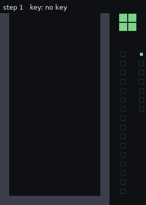</p>

<p align="center"><i>A complete game, 512 steps from an empty board to top-out. Every frame is a forward pass of the network. The page draws the 12 binary channels the network returns. It contains no Tetris rule.</i></p>

| | |
|---|---|
| **Nodes** | 87: 63 map nodes (21 × 16 cells each) and 24 scalar nodes |
| **Unrolled neurons** | 21,192 (63 × 336 cells + 24 scalars), sharing 1,035 parameters |
| **Parameters** | 948 weights + 87 biases, using 14 distinct values |
| **Depth** | 14 levels |
| **State** | 12 binary channels on a 21 × 16 grid; no hidden state |
| **Non-network code at run time** | 145-line executor (`engine.js`) and about 55 lines of page script |
| **Deployment** | one static HTML file, about 19 KB |
| **Training or generator code** | none: no data, loss, gradient, search, fitting or weight-emitting program |

The method is [Weight-Space Programming](https://rikiyat.github.io/blog/weight-space-programming/): reason about what each node must compute, then write the weights that compute it. Here the rule was taken literally. No generator program was allowed, so every value was decided and typed directly into a text file. See [Classification](#how-do-we-classify-what-this-is) for how far the label fits.

**Play:** clone the repository and open `play.html`. The arrow keys move, rotate (up) and soft drop (down); P pauses and N starts a new game.

## Contents

- **[Start here](#start-here)**: [The goal](#the-goal-that-started-it) · [Run it](#run-it) · [Status](#status)
- **[How it works](#how-it-works)**: [One tick](#the-whole-game-is-one-function) · [The equation](#the-equation-explained) · [Neurons to logic](#from-neurons-to-logic) · [Weight sharing](#one-rule-many-cells-weight-sharing) · [The screen as memory](#the-screen-is-the-memory) · [Activity](#what-fires-on-each-event)
- **[How it is put together](#how-it-is-put-together)**: [Connections](#how-everything-is-connected) · [Every node](#every-part-and-why-it-exists) · [Boundaries](#what-is-not-the-network)
- **[What kind of thing is this?](#what-kind-of-thing-is-this)**: [Circuits](#is-it-a-circuit) · [Classification](#how-do-we-classify-what-this-is) · [Determinism](#determinism-and-hallucinations)
- **[Evidence and reference](#evidence-and-reference)**: [Verification](#how-it-is-checked) · [Design decisions](#design-decisions) · [Repository tour](#repository-tour)

## Start here

### The goal that started it

The project owner and a language model drafted the goal together, settled the open questions, and then set it as the standing goal word for word. The full text is in [`GOAL.md`](GOAL.md). Its key constraints:

* **Parameters are text.** Every weight and bias is a float in a text file, and it may only be created or changed by editing that file.
* **No training.** No gradient descent, evolutionary search, RL or data fitting.
* **No generators.** No program, script, formula engine or template may produce weight values. This is the main difference from [SynapseWrite](https://github.com/dirktheeng/SynapseWrite), where a generator program writes the weights.
* **Read-only debugging.** Forward passes may be run to watch a failure. The cause is found by reading the weight files, never with a program that analyzes them.
* **Thin host.** The framework loads the files, applies the fixed architecture, encodes keys, supplies one random number and draws the output. It may not contain game logic.

Questions settled before work began:

| Question | Decision |
|---|---|
| Forward passes while debugging | allowed |
| Randomness | the host supplies one uniform number per step; the network maps it to a piece |
| Input and output | screen and keys in, next screen out |
| Board | standard 10 × 20 |
| Size | as compact as possible, with every choice explained |
| Activations | any, with a stated reason |

### Run it

```bash
git clone https://github.com/dirktheeng/WeightSpaceTetris.git
cd WeightSpaceTetris
# open play.html in a browser; after editing any weight file:
node build.js
```

### Status

All four acceptance criteria are met: a complete game is playable to top-out; every tetromino spawns, moves, rotates, locks, clears and scores; an audit finds no logic in the host ([`AUDIT.md`](AUDIT.md)); and every weight file is documented ([`DESIGN.md`](DESIGN.md)).

**Known gaps, stated plainly:**

- **Scoring** counts lines (binary, up to 65,535) rather than the classic 100/300/500/800 points.
- **No hard drop, no hold, no lock delay, no levels.**
- **Classic rotation.** Pieces turn about a pivot cell, like NES Tetris, with no SRS wall kicks.
- **Uniform random pieces,** not a 7-bag.
- **Browser testing is limited.** The network was tested in the Node harness, and the built page's own script was run headless in Node. Play in a real browser has not been confirmed by the author.

## How it works

### The whole game is one function

<p align="center">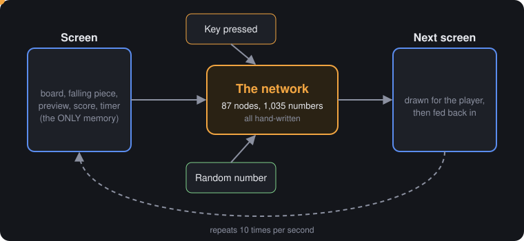</p>

Ten times a second the host runs one forward pass:

```
(screen, key, random number)  ->  next screen
```

The output screen is drawn, then fed straight back in as the next input. The network has no hidden memory. Everything the game remembers is on the screen: the stack, the falling piece and its pivot, the next piece, the score, a gravity timer and the game-over flag.

### The equation, explained

<p align="center">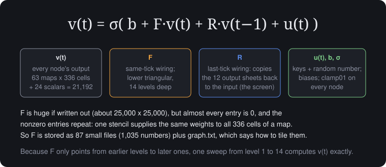</p>

The same equation SynapseWrite uses describes this network:

```
v(t) = σ( b + F·v(t) + R·v(t−1) + u(t) )
```

| Symbol | Meaning here | Size |
|---|---|---|
| `v(t)` | every node output at tick `t`, flattened | 21,192 numbers |
| `F` | same-tick wiring: which outputs feed which nodes, and how strongly | about 25,000 × 25,000, almost all zero |
| `R` | last-tick wiring: an identity that copies the 12 output channels into the 12 input channels. It holds no weights; the host's loop does the copy | 4,032 cells |
| `b` | one bias per node, shared by all its cells | 87 numbers |
| `u(t)` | outside input: 4 key bits and 1 random number | 5 numbers |
| `σ` | `clamp01(x) = min(1, max(0, x))`, for every node | |

**Why `v(t)` appears on both sides.** Nodes are ordered so each reads only from earlier ones, which makes `F` strictly lower triangular. One sweep in order, level 1 to level 14, fills in `v(t)` exactly. It is forward substitution, not an iteration.

**Why `F` is so small on disk.** Each map node applies the same small kernel at every one of its 336 cells. So `F` is block-Toeplitz: a few numbers repeated thousands of times. The repetition pattern (which node reads which, with what window) lives in `graph.txt`. The values live in 87 small files. Unrolled, `F` would be enormous. Stored, it is 1,035 numbers.

#### Layer by layer: the sizes

<p align="center">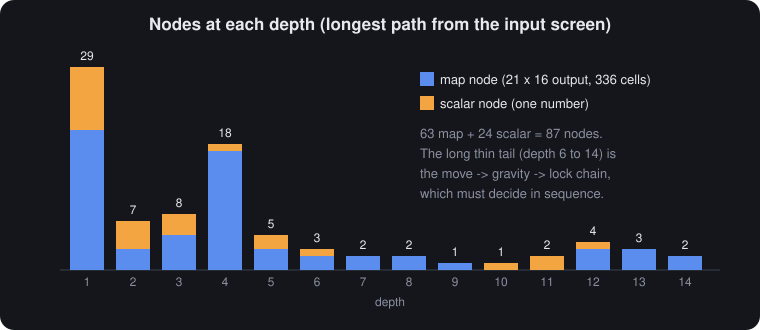</p>

Depth is the longest path from the input screen. These counts come from `graph.txt` by hand.

| Depth | Nodes | What sits there |
|---:|---:|---|
| 1 | 29 | raw facts: overlaps for left and right, the 12 rotation detectors, row-full map, thresholds on the random number, timer shift, fixtures |
| 2 | 7 | reductions (any overlap? any full row?), the rotated piece, gravity enable |
| 3 to 5 | 31 | move and rotate decisions, the spawn decision, keep or shift for each stack cell, preview selection, score carry |
| 6 to 8 | 7 | combine the chosen move into one piece and pivot; the game-over flag |
| 9 to 11 | 4 | try falling one row, decide fall or lock |
| 12 to 14 | 9 | apply gravity, merge in a spawned piece, write the new stack |

The thin tail is the critical path: move, then try gravity on the *moved* piece, then lock or fall, then merge with a spawn. Those decisions depend on each other, so they cannot run side by side.

#### Real nodes, and their weights

<p align="center">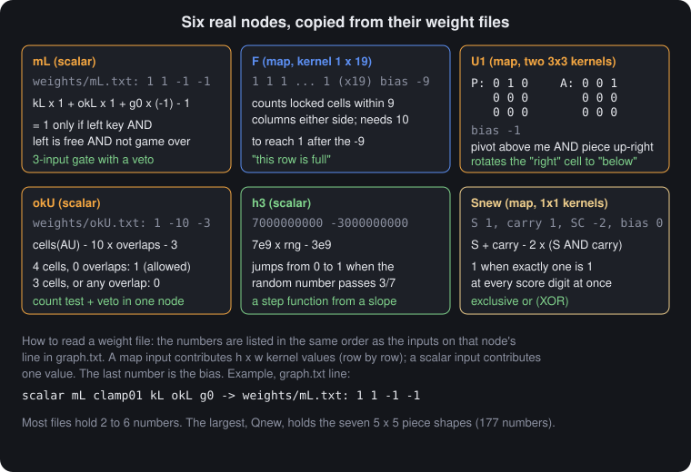</p>

Each card is copied from the weight file. A file lists its numbers in the same order as the inputs on that node's line in `graph.txt`, with the bias last.

#### What the weights and biases look like

<p align="center">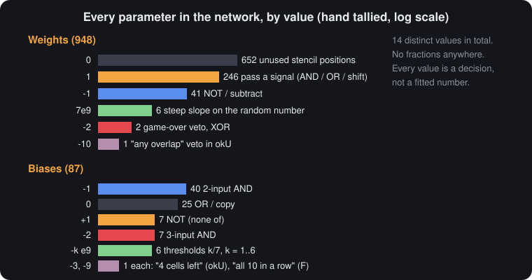</p>

Trained networks have weights that look like continuous noise. These do not, because each value was chosen for a logical reason. The counts were tallied by reading all 87 files (no script reads the weights, under the project rules).

| Value | Count | Role |
|---|---:|---|
| 0 | 652 weights, 25 biases | unused stencil positions; biases of OR and copy nodes |
| 1 | 246 weights, 7 biases | pass a signal; the bias of NOT |
| −1 | 41 weights, 40 biases | NOT or subtract; the bias of a two-input AND |
| −2 | 2 weights, 7 biases | game-over veto in `g`, XOR in `Snew`; the bias of a three-input AND |
| −3, −9, −10 | one each | `okU` "still 4 cells", `F` "all 10 in a row", `okU` overlap veto |
| 7×10⁹ and −k×10⁹ | 6 weights, 6 biases | a steep slope that turns the random number into steps at k/7 |

Most of the zeros are padding inside kernels. A 5 × 5 rotation stencil holds one `1` and twenty-four zeros, because the window has to reach two cells but only one offset matters.

#### Every weight, drawn

<p align="center"><a href="docs/img/weight_atlas.png">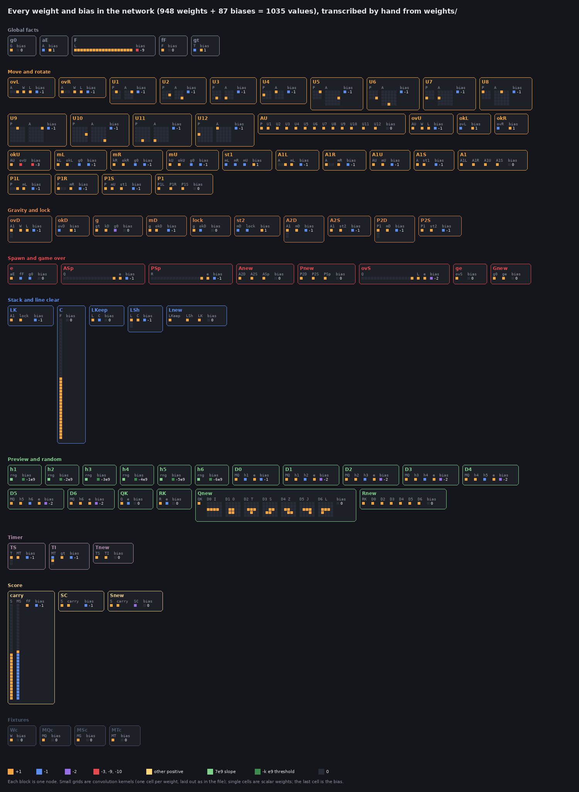</a></p>

Each block is one node. Small grids are convolution kernels, one cell per weight, in the same layout as the file. Single cells are scalar weights, and the last cell is the bias. You can read the design straight off the picture: the rotation detectors (`U1` to `U12`) are pairs of one-hot grids; `Qnew` holds the seven tetromino stamps; `F`, `C` and `carry` are long strips of ones that count along a row or a column. In keeping with the project rule, the drawing script ([`docs/figures_src/weight_atlas.py`](docs/figures_src/weight_atlas.py)) does not read the weight files. Every value in it was transcribed by hand, and its totals (948 weights, 87 biases) match the hand tally above.

### From neurons to logic

<p align="center">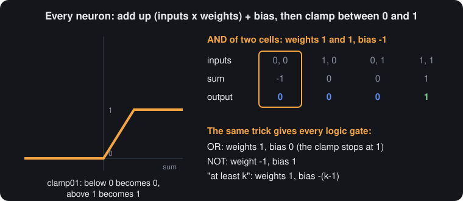</p>

Every cell of every node computes `clamp01(Σ inputs × weights + bias)`. All screen values are 0 or 1 and almost all weights are small integers, so every pre-activation is an integer. On integers, clamp01 is an exact gate:

| Gate | Weights | Bias |
|---|---|---|
| AND of n | 1, …, 1 | −(n−1) |
| OR | 1, …, 1 | 0 |
| NOT | −1 | 1 |
| at least k | 1, …, 1 | −(k−1) |
| XOR(a, b) | a + b − 2·AND(a, b) | 0, using one extra AND node |

**Why clamp01 and not something else.** ReLU would let an OR of two ones become 2, which would need another layer to renormalize. A sigmoid never gives exactly 0 or 1, so errors would build up over thousands of ticks. clamp01 keeps every value in {0, 1} forever, so step 10,000 is as exact as step 1.

This is the same idea as SynapseWrite's gate, at a smaller scale. SynapseWrite gates whole numbers with weights of 2⁴⁰. Here everything is a single bit, so weights of ±1 and ±2 are enough.

### One rule, many cells: weight sharing

<p align="center"></p>

Tetris rules are the same at every board position, so each rule is a convolution kernel. A kernel with a single 1 is a shift. Shifts combined with gates give every operation in the game:

| Operation | Built from |
|---|---|
| move left or right | shift by one column, AND with "wall or stack", reduce with "any", gate |
| fall | the same, shifting down one row |
| rotate | 12 pairs of shifts (pivot, piece cell), ANDed, then ORed |
| full row | a 1 × 19 all-ones kernel, threshold at 10 |
| clear | a 39 × 1 kernel marks every cell at or above a full row; marked cells take the value of the cell above |
| spawn | shift the preview box 8 columns left |
| score | a 31 × 1 kernel checks all lower bits for a carry |

Without sharing, each rule would be written out at all 336 cells, roughly 100 times more numbers. That would be impossible to write or read by hand.

### The screen is the memory

<p align="center">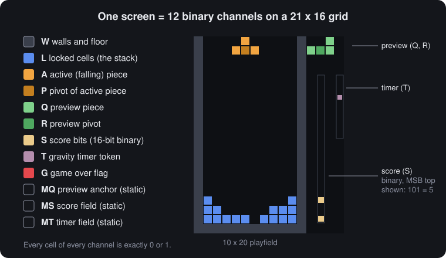</p>

| Channel | Holds | Why it is separate |
|---|---|---|
| `W` | walls and floor | collision becomes one test against `W ∨ L`; walls never count toward a full row |
| `L` | locked cells | the stack |
| `A`, `P` | falling piece, pivot | moved independently of the stack; the pivot is the rotation center |
| `Q`, `R` | preview piece, pivot | spawn becomes one copy |
| `S` | 16-bit score | |
| `T` | timer token | gravity timing is a game rule, so it lives on the screen |
| `G` | game over (lights the whole sheet) | |
| `MQ`, `MS`, `MT` | static markers | let position-blind kernels find the preview box, score and timer |

Four identity nodes copy the static channels, so the network writes the entire next screen and the host carries nothing forward.

### What fires on each event

<p align="center">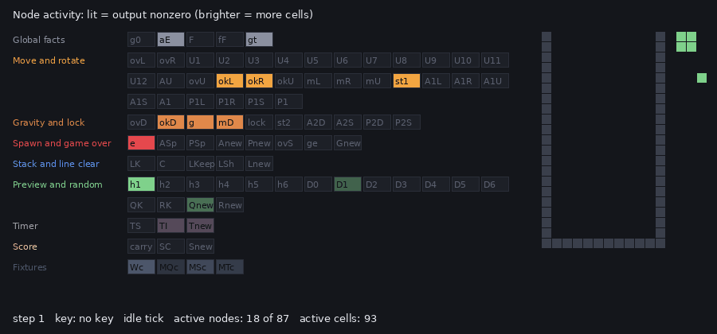</p>

This animation is recorded from real forward passes. Each box is a node, lit when its output is nonzero. The recorder ([`docs/figures_src/activity.js`](docs/figures_src/activity.js)) reads node *outputs* during play, never the weight files.

| Event | Nodes active | Cells active |
|---|---:|---:|
| idle tick (no piece) | 18 of 87 | 93 |
| spawn | 20 | 101 |
| rotate | 27 | 114 |
| move | 29 | 128 |
| fall one row | 30 | 129 |
| lock | 27 | 129 |
| line clear | 21 | 301 |

Most of the active *cells* on an idle tick belong to the four fixture nodes copying walls and markers (76 cells). A line clear lights the most cells because the whole stack above the full row is rewritten. The engine evaluates every node densely, with no sparsity tricks, and one step still takes about 0.36 ms on a single 2.1 GHz Xeon core.

## How it is put together

### How everything is connected

<p align="center">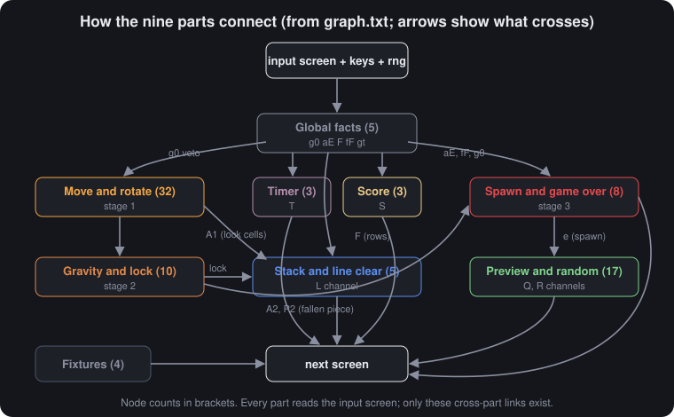</p>

The whole game is one graph of 87 nodes. The parts below are labels for groups of those nodes; there is no boundary between them in the weights. Every part reads the input screen. Beyond that, only the links in the figure exist. The `g0` (game over) signal is the widest: it vetoes every action.

### Every part, and why it exists

Node names match `graph.txt` and the files in `weights/`.

#### Global facts (5 nodes)

| Node | What it computes | Why it exists |
|---|---|---|
| `g0` | any `G` cell lit | game over must freeze every action |
| `aE` | no falling piece | spawning happens only then |
| `F` | this cell is in a full row | the start of line clearing; 1 × 19 kernel of ones, bias −9 |
| `fF` | some row is full | blocks spawning until clearing finishes; drives the score |
| `gt` | timer token has left its field | the gravity tick |

#### Move and rotate (32 nodes)

| Node | What it computes | Why it exists |
|---|---|---|
| `ovL`, `ovR` | piece shifted left or right, AND (wall or stack) | the speculative collision test |
| `okL`, `okR` | no overlap anywhere | one yes or no for the whole move |
| `U1` to `U12` | rotation detectors, one per offset from the pivot | turns the piece a quarter turn without any lookup table |
| `AU` | pivot OR all detectors | the rotated piece |
| `ovU`, `okU` | overlap test, plus "still 4 cells" | rejects blocked turns, turns off the top edge, and the O piece (which has no pivot) |
| `mL`, `mR`, `mU` | key AND ok AND not game over | the decision to act |
| `st1` | no move was made | keeps the piece where it is |
| `A1L`, `A1R`, `A1U`, `A1S`, `A1` | gate each candidate, then OR | the piece after the player's move; exactly one gate is open |
| `P1L`, `P1R`, `P1S`, `P1` | the same for the pivot | rotation leaves the pivot in place |

#### Gravity and lock (10 nodes)

| Node | What it computes | Why it exists |
|---|---|---|
| `ovD`, `okD` | moved piece shifted down, any overlap | can it fall? |
| `g` | (timer tick OR down key) AND not game over | when gravity applies |
| `mD`, `lock`, `st2` | fall, lock, or neither | the three outcomes, mutually exclusive |
| `A2D`, `A2S`, `P2D`, `P2S` | fallen or kept piece and pivot | a locking piece goes into neither and leaves the falling layer |

#### Stack and line clear (5 nodes)

| Node | What it computes | Why it exists |
|---|---|---|
| `LK` | moved piece AND lock | the cells that join the stack |
| `C` | a full row at or below this cell | marks everything that must drop |
| `LKeep`, `LSh` | stay put, or take the cell above | one row is cleared per step |
| `Lnew` | OR of the three | the new stack |

#### Spawn and game over (8 nodes)

| Node | What it computes | Why it exists |
|---|---|---|
| `e` | no piece AND no full row AND not game over | when to spawn |
| `ASp`, `PSp` | preview shifted 8 columns left, gated by `e` | spawning is a copy |
| `Anew`, `Pnew` | fallen, kept or spawned | the next falling piece and pivot |
| `ovS`, `ge`, `Gnew` | spawned piece overlaps the stack | top-out; sets `G` across the sheet |

#### Preview and random (17 nodes)

| Node | What it computes | Why it exists |
|---|---|---|
| `h1` to `h6` | random number ≥ k/7 | thresholds with slope 7×10⁹, so the answer is a clean 0 or 1 |
| `D0` to `D6` | exactly one piece chosen, on a spawn step, at the anchor cell | one-hot selection |
| `QK`, `RK` | keep the old preview when nothing spawns | |
| `Qnew` | stamp the chosen 5 × 5 shape | the seven shapes, mirrored because a kernel *reads* from offsets |
| `Rnew` | place the pivot (all but O) | |

#### Timer (3 nodes)

| Node | What it computes | Why it exists |
|---|---|---|
| `TS` | token moves down its column | the clock ticks |
| `TI` | new token at the top when the column is empty | the clock restarts; period 8 steps (0.8 s) |
| `Tnew` | OR of the two | |

#### Score (3 nodes)

| Node | What it computes | Why it exists |
|---|---|---|
| `carry` | a line was cleared AND every lower bit is 1 | the parallel carry for a binary increment |
| `SC`, `Snew` | bit XOR carry | adds 1 to the 16-bit score |

#### Fixtures (4 nodes)

`Wc`, `MQc`, `MSc` and `MTc` copy the walls and markers (weight 1, bias 0), so the network produces the whole next screen.

### What is not the network

| Code | What it may do | What it never does |
|---|---|---|
| `engine.js` (145 lines) | cross-correlation, global sum, broadcast, clamp, in the order of `graph.txt` | branch on any cell's value |
| page script (about 55 lines) | queue keys (at most 2, one per step), supply `Math.random()`, tick at 10 Hz, paint each channel a color | read the game's meaning: no collision check, no score, no piece logic |
| `build.js` | paste the engine and every text file into `play.html` verbatim | parse or change a value |
| `sim.js`, `play.js`, `docs/` scripts | run forward passes and record outputs, for testing and figures | read the weight files |

[`AUDIT.md`](AUDIT.md) goes through each file.

## What kind of thing is this?

### Is it a circuit?

<p align="center">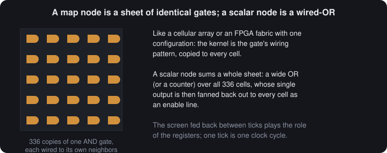</p>

Yes, and more cleanly than most networks, because every value is a single bit.

| Circuit | This network |
|---|---|
| netlist | `graph.txt` plus the kernels |
| combinational logic | one forward pass |
| gate depth | 14 levels |
| registers | the 12 screen channels, fed back by the host |
| clock | one tick (100 ms) |
| replicated logic cells | a map node: one gate configuration repeated at 336 cells |
| wide OR, counter | a scalar node: a sum over a whole sheet, then a threshold |
| enable line | a scalar fanned back out to every cell |

Unlike SynapseWrite, which is mostly mixed-signal (one-bit gates switching whole numbers), this network is **purely digital**. Every node outputs only 0 or 1 at every cell, except the six random-number thresholds, which have a band of width about 10⁻¹⁰ that is never hit in practice. The closest hardware picture is a cellular array, like an FPGA fabric where every cell in a plane has the same configuration.

**Where the comparison stops.** The sums over a whole sheet are evaluated at once, not as a real tree of gates with delays. The board's zero padding plays the role of fixed edge wiring. And the random number is an analog input that the network turns into bits.

### How do we classify what this is?

A **hand-written neural program**: a fixed-function, weight-shared, recurrent threshold network whose weights implement a complete interactive game, every value of which was chosen individually.

| Term | Does it fit? | Why |
|---|---|---|
| **Neural network** | yes, by definition | weighted sums, an activation, layers, recurrence; no learning |
| **Convolutional network** | yes | every map node is a convolution with shared weights |
| **Cellular automaton** | close | the update is local plus a few global reductions; a pure cellular automaton has no global reductions |
| **Circuit** | yes | purely digital; see above |
| **Weight-Space Programming** | yes, in its strictest form | see below |
| **Machine learning** | no | no data, loss, gradient or search |

#### Is this Weight-Space Programming?

**For.** A language model wrote every value directly into the weight files, from a natural-language spec, with no optimizer, compiler or generator. This is the strictest form the original post describes. Unlike [SynapseWrite](https://github.com/dirktheeng/SynapseWrite), where a generator writes the weights and the model rarely reads them, here the weights *are* the source code. Every value was reasoned out individually and is explained in [`DESIGN.md`](DESIGN.md).

**Against, or at least limiting.** The model did not need to *read* weights to debug, because the network worked on its first run, so the "read and repair" half of the method was barely exercised. The design was also worked out in reasoning before any file was written, which is close to compiling by hand. And a 1,035-number network is tiny next to the models in the original post.

How the work actually happened:

| Level of work | How often | Example |
|---|---|---|
| reasoning about what each node must compute | all design | "a cell is part of the rotated piece if the pivot is at x − Rd and a piece cell at x − Rd + d" |
| typing values into weight files | every file, once | `weights/U1.txt` |
| running forward passes and reading screens | all testing | every rotation, clear and the full game |
| reading weight files to find a bug | never needed | no parameter needed changing |

Where the values come from:

- **Chosen for a logical reason:** all of them. Gate weights (±1), gate biases (0, ±1, −2), thresholds (−3, −9), vetoes (−2, −10).
- **Derived from a shape:** the 5 × 5 piece kernels, drawn by hand from the seven tetromino shapes.
- **Chosen for numerics:** the 7×10⁹ slope, picked so the thresholds stay round numbers and the undefined band is negligible.
- **From data or an optimizer:** none.

#### Earlier work it relates to

| Line of work | Example | How weights are made | Relationship |
|---|---|---|---|
| Threshold logic | McCulloch and Pitts, 1943 | designed logic | its foundation |
| Hand-set convolutional automata | [Springer and Kenyon, 2020](https://arxiv.org/abs/2009.01398): a minimal Game of Life network | hand-written | closest relative; they also found that the same minimal network rarely *learns* the rule |
| Neural compilers | [Siegelmann, 1994](https://mlanthology.org/aaai/1994/siegelmann1994aaai-neural); [Gruau et al., 1995](https://gpbib.cs.ucl.ac.uk/gp-html/DBLP_journals_tcs_GruauRW95.html); [Carreira et al., 1998](https://core.ac.uk/download/32330732.pdf) | compiled | same result, made by a compiler |
| Compiled transformers | [Tracr, 2023](https://arxiv.org/abs/2301.05062); [Looped transformers, 2023](https://proceedings.mlr.press/v202/giannou23a.html) | compiled or constructed | programmed weights, different goals |
| Generator-written apps | [SynapseWrite](https://github.com/dirktheeng/SynapseWrite): a word processor as one network | generator program | sibling project, written one level up |
| Learned game engines | [GameNGen, 2024](https://arxiv.org/abs/2408.14837) (DOOM); World Models; GameGAN | trained on recorded play | the opposite method: far richer games, approximate rather than exact |

**What may be different here.** These may be unusual, but they have not been checked against a full literature survey, so no claim to be first is made:

- **A complete interactive game with every parameter hand-written,** with no compiler and no generator.
- **Global game rules in a convolutional automaton.** Life needs only local rules. Tetris also needs "is any cell blocked?", "is any row full?" and "is the game over?", handled here by scalar reduce-and-broadcast nodes.
- **The whole state is the visible screen,** including the clock, the random choice and the score.

### Determinism and hallucinations

#### Same input, same output

The only randomness is the number the host passes in. Given the same starting screen, keys and random numbers, the output is identical every time. The recorded game (`tests/full_game_seed42.txt` with seed 42) replays to the same final screen in both the Node harness and the built `play.html`. In the browser, `Math.random()` supplies the number, so piece sequences differ from game to game, by design.

#### Exactly repeatable, and exact

Every pre-activation except the six random-number thresholds is a small integer, so the arithmetic is exact in floating point, not just repeatable. There is no rounding anywhere in the game logic. The thresholds compute `7×10⁹ · r − k×10⁹`. For that to land strictly between 0 and 1, `r` would have to fall in a band about 1.4×10⁻¹⁰ wide just above k/7. That would show as a half-lit preview cell, and it is the only possible non-binary value in the system.

#### Can it hallucinate?

No. There are no learned statistics, no generated content and no confidence. A rule either matches or it does not. A wrong result would be an ordinary bug: repeatable, traceable to a specific node and fixed by editing that file. This README and the design note were written with a language model too. Every number in them was checked against the files or measured from forward passes, but documentation can still contain errors that the running network cannot.

## Evidence and reference

### How it is checked

All checks drive the network with keys and judge only the output screens.

| Check | What it shows |
|---|---|
| wall tests | lateral moves stop at both walls |
| rotation tests | T and I cycle through four orientations; a turn into a wall is refused |
| `tests/clear_<piece>.txt` × 7 | for each tetromino: move, drop, complete a row, clear it, score 0 → 1 |
| `tests/clear4.txt` | four rows clear on four consecutive steps; the score counts 1 → 5 in binary |
| random sweep | the seven bins of the random number produce I, O, T, S, Z, J, L |
| `tests/full_game_seed42.txt` | a 512-step game played one decision at a time, all pieces used, a line cleared, ending in top-out; `play.html` replays it to the same final screen |
| [`AUDIT.md`](AUDIT.md) | the host contains no game logic |

**Latency:** about 0.36 ms per forward pass, measured in Node on one 2.1 GHz Xeon core with dense evaluation. The tick period is 100 ms.

### Design decisions

| Decision | Alternative considered | Reason |
|---|---|---|
| the screen is the whole state | hidden recurrent state | required by the goal; makes everything observable |
| 12 binary channels | one channel with codes | codes need decoding layers; binary channels make every rule a gate |
| a separate wall channel | treat the edge as a wall | uniform collision test; walls stay out of the row count |
| clamp01 everywhere | ReLU, sigmoid | exact gates; stays binary under recurrence |
| convolution | dense layers | about 100 times fewer numbers; each rule written once |
| try the move, then test for overlap | compute legal moves directly | the smallest exact collision check, reused for every move |
| pivot rotation with 12 detectors | tables per piece and orientation | one mechanism for all pieces; O handled by the "4 cells" test |
| classic rotation | SRS with wall kicks | kicks need many more nodes |
| spawn by copying the preview | draw each spawn from scratch | one copy kernel |
| one line cleared per step | clear all lines at once | a fixed kernel cannot shift by a variable amount; line counting becomes exact |
| timer on the screen | a tick from the host | timing is game logic |
| binary line count | classic points | multi-line clears are never seen at once; 16 cells count to 65,535 |

### Repository tour

| Path | What is there |
|---|---|
| `graph.txt` | architecture: node types, wiring, kernel windows |
| `weights/` | 87 hand-written weight files |
| `screen0.txt` | the starting screen |
| `engine.js` | the executor |
| `play.template.html`, `build.js`, `play.html` | the browser host and the built game |
| `sim.js`, `play.js` | forward-pass harnesses (scripted, and one decision at a time) |
| `tests/` | test screens and the recorded game |
| `GOAL.md`, `DESIGN.md`, `AUDIT.md` | goal, per-file design note, host audit |
| `docs/img/` | figures (hand-drawn) and animations (recorded from forward passes) |
| `docs/make_gifs.py`, `docs/figures_src/` | recorders: they read screens and node outputs, never weights |

```sh
node sim.js screen0.txt "..lllrrrdddd" 1 1                          # scripted run, text output
node sim.js screen0.txt "$(cat tests/full_game_seed42.txt)" 42 1    # replay the recorded game
python3 docs/make_gifs.py; python3 docs/figures_src/activity_gif.py  # re-record animations
```

### References

* *Weight-Space Programming* (blog post). https://rikiyat.github.io/blog/weight-space-programming/
* W. S. McCulloch and W. Pitts, "A Logical Calculus of the Ideas Immanent in Nervous Activity," *Bulletin of Mathematical Biophysics*, 1943.
* J. M. Springer and G. T. Kenyon, "It's Hard for Neural Networks to Learn the Game of Life," 2020. https://arxiv.org/abs/2009.01398
* D. Lindner et al., "Tracr: Compiled Transformers as a Laboratory for Interpretability," 2023. https://arxiv.org/abs/2301.05062
* A. Giannou et al., "Looped Transformers as Programmable Computers," ICML 2023. https://proceedings.mlr.press/v202/giannou23a.html
* D. Valevski et al., "Diffusion Models Are Real-Time Game Engines," 2024. https://arxiv.org/abs/2408.14837
* SynapseWrite, a word processor as one weight-programmed network. https://github.com/dirktheeng/SynapseWrite
