<h1 align="center">WeightSpaceTetris</h1>
<p align="center"><b>Tetris that is one neural network.</b><br>Nobody trained it. Every one of its 1,035 numbers was typed by hand.</p>

<p align="center"></p>

<p align="center"><i>A complete game: 512 network steps from an empty board until the stack reaches the top (every second step is shown). Each frame shows the 12 channels the network returned. No code outside the network decides anything about the game.</i></p>

| | |
|---|---|
| **Nodes** | 87: 63 map nodes (one value per screen cell) and 24 scalar nodes (one value each) |
| **Unrolled size** | 21,192 cell outputs (63 × 336 + 24), all sharing 1,035 parameters |
| **Parameters** | 948 weights + 87 biases, using 14 distinct values |
| **Depth** | 14 |
| **State** | 12 binary channels on a 21 × 16 grid, with no hidden state |
| **Code outside the network** | a 145-line executor (`engine.js`) and about 55 lines of page script |
| **Deployment** | one static HTML file, about 19 KB |
| **Training or generator code** | none: no data, loss, gradient, search, fitting, or program that writes weights |

The network maps the current screen, the key pressed and one random number to the next screen. Its rules were written in the style of [Weight-Space Programming](https://rikiyat.github.io/blog/weight-space-programming/): reason about what each node must compute, then write the weights that compute it. Here that was taken literally. No program was allowed to produce weights, so every value was decided and typed directly into a text file.

**Play:** clone the repository and open `play.html` in a browser. Left and right move, up rotates, down drops faster; P pauses and N starts a new game. After editing any weight file, run `node build.js` to rebuild the page.

## Contents

- **[Status](#status)**
- **[How it works](#how-it-works)**: [One step](#one-step-is-one-function) · [The screen](#the-screen-is-the-memory) · [Nodes are gates](#nodes-are-logic-gates) · [Kernels](#kernels-one-rule-for-every-cell) · [The nine parts](#the-nine-parts) · [The equation](#the-equation-and-its-depth) · [The weights](#the-weights-themselves) · [Activity](#what-fires-on-each-event)
- **[Every node, by part](#every-node-by-part)**: [Global facts](#global-facts-5-nodes) · [Move and rotate](#move-and-rotate-32-nodes) · [Gravity and lock](#gravity-and-lock-10-nodes) · [Stack and line clear](#stack-and-line-clear-5-nodes) · [Spawn and game over](#spawn-and-game-over-8-nodes) · [Preview and random](#preview-and-random-17-nodes) · [Timer](#timer-3-nodes) · [Score](#score-3-nodes) · [Fixtures](#fixtures-4-nodes) · [Outside the network](#what-is-not-the-network)
- **[Project rules](#project-rules)**
- **[What kind of thing is this?](#what-kind-of-thing-is-this)**: [Circuits](#is-it-a-circuit) · [Classification](#how-do-we-classify-it) · [Related work](#related-work) · [Determinism](#determinism)
- **[Evidence and reference](#evidence-and-reference)**: [Checks](#how-it-is-checked) · [Design decisions](#design-decisions) · [Repository tour](#repository-tour) · [References](#references)

## Status

All four acceptance criteria in [`GOAL.md`](GOAL.md) are met:

1. A complete game can be played until the stack reaches the top.
2. Every tetromino spawns, moves, rotates, locks, clears lines and scores.
3. An audit finds no game logic outside the network ([`AUDIT.md`](AUDIT.md)).
4. Every weight file is documented ([`DESIGN.md`](DESIGN.md)).

**Known gaps:**

- **Scoring** counts cleared lines in binary (up to 65,535). It does not use the classic 100/300/500/800 point table.
- **No hard drop, no hold, no lock delay and no levels.**
- **Classic rotation.** Pieces turn about a pivot cell, as in NES Tetris. There are no SRS wall kicks.
- **Pieces are drawn uniformly at random,** not from a 7-bag.
- **Browser testing is limited.** The network was tested in the Node harness, and the built page's script was run headless in Node. Play in a real browser has not been confirmed by the author.

## How it works

### One step is one function

<p align="center"></p>

Ten times a second the host runs one forward pass:

```
(screen, key, random number)  ->  next screen
```

The output screen is drawn, then fed straight back in as the next input. The network has no hidden memory. Everything the game remembers is on the screen.

### The screen is the memory

<p align="center"></p>

The screen is a grid of 21 rows by 16 columns. Columns 1 to 10 and rows 0 to 19 are the 10 × 20 playfield. Columns 0 and 11 are walls and row 20 is the floor. Columns 12 to 15 are a side panel: the preview box at the top, the score in column 13 and the gravity timer in column 15.

Each cell holds 12 binary **channels**, like the color planes of an image. Every value on every channel is exactly 0 or 1.

| Channel | Holds | Why it is a separate channel |
|---|---|---|
| `W` | walls and floor | collision becomes one test against "wall or stack"; walls never count toward a full row |
| `L` | locked cells | the stack |
| `A`, `P` | falling piece, its pivot | the piece moves independently of the stack; the pivot is the rotation center |
| `Q`, `R` | preview piece, its pivot | spawning becomes a single copy |
| `S` | 16-bit score | |
| `T` | timer token | gravity timing is a game rule, so it lives on the screen |
| `G` | game over (every cell set) | |
| `MQ`, `MS`, `MT` | static markers | let position-blind kernels find the preview box, score and timer |

The static channels (`W`, `MQ`, `MS`, `MT`) never change. Four copy nodes reproduce them, so the network writes the entire next screen and the host carries nothing forward.

### Nodes are logic gates

<p align="center"></p>

Every node computes, at each of its cells, `clamp01(weighted sum of inputs + bias)`, where `clamp01(x) = min(1, max(0, x))`. The inputs are 0 or 1 and almost every weight is a small integer. So the sum before the clamp is always an integer, and the clamp turns each node into an exact gate:

| Gate | Weights | Bias |
|---|---|---|
| AND of n inputs (at least n of n) | 1, …, 1 | −(n−1) |
| at least k of n | 1, …, 1 | −(k−1) |
| OR (at least 1) | 1, …, 1 | 0 |
| NOT | −1 | 1 |
| XOR(a, b) | 1, 1, −2 on a, b and a separate AND(a, b) node | 0 |

clamp01 is the only activation. ReLU would let an OR of two ones become 2, which would need another node to bring it back to 1. A sigmoid never gives exactly 0 or 1, so small errors would build up over thousands of steps. With clamp01 every value stays exactly 0 or 1, so step 10,000 is as exact as step 1.

### Kernels: one rule for every cell

<p align="center"></p>

Tetris rules are the same at every board position, so each rule is a **kernel**: a small grid of weights that the executor applies at every cell of a map node. A kernel with a single 1 moves a channel by one cell. Kernels plus gates build every operation in the game:

| Operation | Built from |
|---|---|
| move left or right | shift the piece one column; AND with "wall or stack"; ask whether any cell overlaps; gate the move |
| fall | the same, shifting down one row |
| rotate | 12 pairs of one-hot kernels (pivot, piece cell), each ANDed, then all ORed |
| detect a full row | a 1 × 19 kernel of ones, with a threshold at 10 |
| clear it | a 39 × 1 kernel marks every cell at or above a full row; marked cells take the value of the cell above |
| spawn | shift the preview box 8 columns left |
| add 1 to the score | a 31 × 1 kernel checks all lower bits for a carry |

Weight sharing is what makes hand authorship possible. Almost every parameter belongs to a map node and is reused at all 336 cells. Written out cell by cell, the network would need about 300 times as many numbers.

The executor computes `out(y, x) = Σ k(i, j) · in(y + i − c, x + j − c)` with zero padding, which is cross-correlation. A kernel therefore *reads* from an offset: a 1 at offset +1 copies the cell to the right, which moves the piece left. To *stamp* a shape at offsets c, the kernel holds the shape mirrored, with the 1s at −c.

### The nine parts

<p align="center"></p>

The 87 nodes fall into nine **parts**, named for what they do. The figure shows every link between parts and the signals that cross it. Every part also reads the input screen directly.

<p align="center">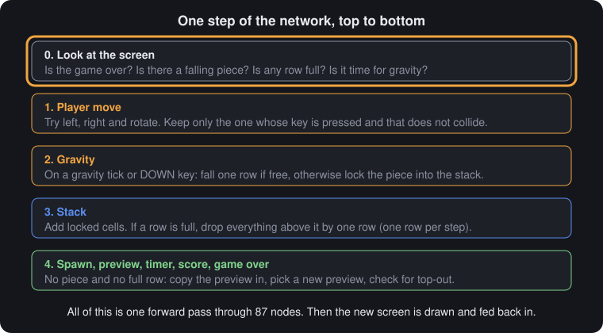</p>

Within one step the work runs in a fixed order. First, global facts are read from the screen. Then the player's move is applied, then gravity, then the stack is updated, and last a new piece spawns if needed. Each later stage uses the result of the earlier one; gravity, for example, acts on the piece *after* the player's move.

### The equation and its depth

<p align="center"></p>

The whole step is one equation:

```
v(t) = σ( b + F·v(t) + R·v(t−1) + u(t) )
```

| Symbol | Meaning here | Size |
|---|---|---|
| `v(t)` | the state vector: the 12 input channels and 5 outside inputs (held fixed during the step), followed by every node's output | 4,037 + 21,192 ≈ 25,200 values |
| `F` | same-step wiring: which values feed which node cells, and with what weight | about 25,200 × 25,200, almost all zero |
| `R` | previous-step wiring: copies the 12 output channels back into the input channels. It holds no weights; the host's loop does the copy | 4,032 cells |
| `b` | one bias per node, shared by all its cells | 87 values |
| `u(t)` | outside input: four key bits and one random number | 5 values |
| `σ` | clamp01, at every node | |

`v(t)` appears on both sides, but nothing is circular. Each node reads only from inputs and earlier nodes, so `F` is strictly lower triangular. One pass over the nodes in order computes `v(t)` exactly; it is forward substitution, not iteration. Because each kernel repeats at every cell, `F` is made of a few small blocks repeated many times. It is stored as 87 small files plus `graph.txt`, which says how to tile them.

<p align="center"></p>

A node's **depth** is the length of its longest path from the input screen.

| Depth | Nodes | What sits there |
|---:|---:|---|
| 1 | 29 | direct readings of the screen: overlaps for left and right moves, the 12 rotation detectors, the full-row map, thresholds on the random number, the timer shift, and the four copies of the static channels |
| 2 | 7 | "is any cell set?" checks, the rotated piece, the gravity enable, the line-clear marks |
| 3 to 5 | 31 | move and rotate decisions, the spawn decision, keep or shift for each stack cell, the preview choice, the score carry |
| 6 to 8 | 7 | the chosen move combined into one piece and pivot; the game-over flag |
| 9 to 11 | 4 | try falling one row; decide whether to fall or lock |
| 12 to 14 | 9 | apply gravity, merge in a spawned piece, write the new stack |

The long thin tail is the critical path. The game tries the player's move, then gravity on the *moved* piece, then decides between falling and locking, then merges any new piece. Each decision needs the one before it.

### The weights themselves

<p align="center"></p>

Each card above is copied from its weight file. A file lists its numbers in the same order as the inputs on that node's line in `graph.txt`, with the bias last.

<p align="center"></p>

Trained networks have weights that look like continuous noise. These do not, because each value was chosen for a reason. The counts were tallied by reading all 87 files by eye, because under the project rules no program may read the weights. Bar length is on a log scale.

| Value | Count | Role |
|---|---:|---|
| 0 | 652 weights, 25 biases | unused kernel positions; the bias of OR and copy nodes |
| 1 | 246 weights, 7 biases | pass a signal; the bias of NOT |
| −1 | 41 weights, 40 biases | NOT or subtract; the bias of a two-input AND |
| −2 | 2 weights, 7 biases | the game-over veto in `g`, the XOR in `Snew`; the bias of a three-input AND |
| −3 and −9 (biases), −10 (weight) | one each | `okU` "still 4 cells", `F` "all 10 in a row", `okU` overlap veto |
| 7×10⁹ (weights), −k×10⁹ (biases) | 6 each | a steep slope that turns the random number into steps at k/7 |

Most zeros are padding inside kernels. For example, a 5 × 5 rotation kernel holds a single 1, because the window must reach two cells away but only one offset matters.

<p align="center"><a href="docs/img/weight_atlas.png"></a></p>

The atlas draws every value. Each block is one node. Small grids are kernels, laid out as in the file. Single cells are scalar weights, and the last cell is the bias. The design reads straight off the picture. The rotation detectors `U1` to `U12` are pairs of one-hot grids. `Qnew` holds the seven tetromino stamps. `F`, `C` and `carry` are long strips that count along a row or a column. The drawing script ([`docs/figures_src/weight_atlas.py`](docs/figures_src/weight_atlas.py)) does not read the weight files. Every value in it was transcribed by hand, and its totals (948 weights, 87 biases) match the hand tally.

### What fires on each event

<p align="center"></p>

This animation is recorded from real forward passes. Each box is a node, lit when any of its cells is nonzero. The recorder ([`docs/figures_src/activity.js`](docs/figures_src/activity.js)) reads node outputs during play, never the weight files.

| Event (one sample of each) | Nodes active | Cells active |
|---|---:|---:|
| idle step, no piece | 18 of 87 | 93 |
| spawn | 20 | 101 |
| rotate | 27 | 114 |
| move | 29 | 128 |
| fall one row | 30 | 129 |
| lock | 27 | 129 |
| line clear | 21 | 301 |

The counts depend on the board, so other steps of the same kind differ a little. Most active cells on an idle step belong to the four copy nodes reproducing the static channels (76 cells). A line clear lights the most cells because the whole stack above the full row is rewritten.

## Every node, by part

Node names match `graph.txt` and the files in `weights/`. A **veto** below means a weight that forces a gate to 0, such as `g0` (game over) subtracted from every action.

### Global facts (5 nodes)

| Node | What it computes | Why it exists |
|---|---|---|
| `g0` | some cell of `G` is set | game over must freeze every action |
| `aE` | no falling piece | spawning happens only then |
| `F` | this cell lies in a full row (1 × 19 kernel of ones, bias −9) | the start of line clearing |
| `fF` | some row is full | blocks spawning until clearing finishes; adds to the score |
| `gt` | the timer column is empty (the token has run off its end) | the gravity tick |

### Move and rotate (32 nodes)

<p align="center">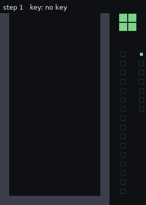 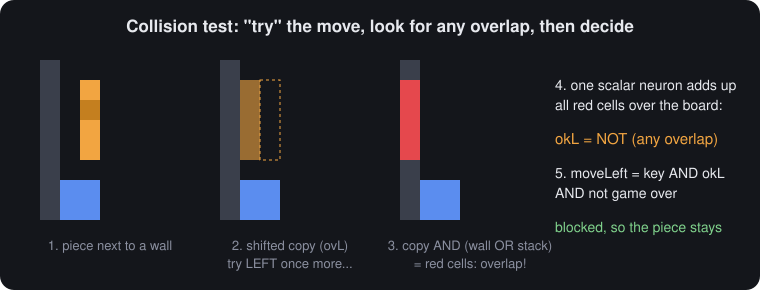</p>

A move is tested before it is made. The node shifts a copy of the piece, ANDs it with "wall or stack", and asks whether any cell overlaps.

<p align="center">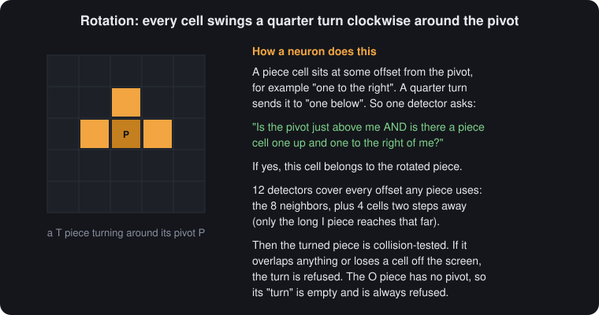</p>
<p align="center">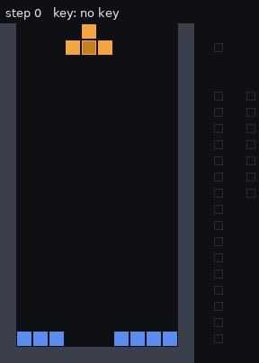 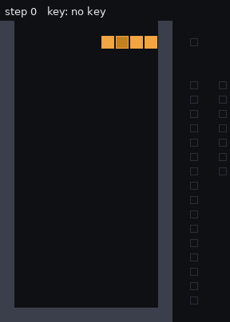</p>

Clockwise rotation in screen coordinates (y down) sends an offset `d = (dx, dy)` from the pivot to `Rd = (−dy, dx)`. For each of the 12 offsets that any piece uses, a detector fires at cell `x` when the pivot is at `x − Rd` and a piece cell is at `x − Rd + d`. That is one AND of two one-hot kernels, and its output lands directly on the rotated cell.

| Node | What it computes | Why it exists |
|---|---|---|
| `ovL`, `ovR` | piece shifted left or right, AND "wall or stack" | finds the overlap cells for each move |
| `okL`, `okR` | no overlap anywhere | one yes or no for the whole move |
| `U1` to `U12` | the rotation detectors (`U1` to `U4` beside the pivot, `U5` to `U8` diagonal, `U9` to `U12` two cells away, used only by the I piece) | rotate the piece with no lookup tables |
| `AU` | pivot OR all detectors | the rotated piece |
| `ovU` | rotated piece AND "wall or stack" | overlap for the rotation |
| `okU` | cells in `AU` − 10 × overlaps − 3 | 1 only if the turned piece still has 4 cells and overlaps nothing; this refuses blocked turns, turns that would push a cell off the top of the screen, and the O piece, which has no pivot |
| `mL`, `mR`, `mU` | key AND ok AND not game over | the decision to act |
| `st1` | none of the moves happened | keeps the piece in place |
| `A1L`, `A1R`, `A1U`, `A1S` | each candidate piece, gated by its decision | exactly one gate is open, because at most one key arrives per step |
| `A1` | OR of the four | the piece after the player's move |
| `P1L`, `P1R`, `P1S`, `P1` | the same for the pivot | rotation leaves the pivot in place |

### Gravity and lock (10 nodes)

<p align="center"> </p>

| Node | What it computes | Why it exists |
|---|---|---|
| `ovD`, `okD` | moved piece shifted down one row; any overlap | can it fall? |
| `g` | (timer tick OR down key) AND not game over; the game-over weight is −2 so it outweighs both | when gravity applies |
| `mD`, `lock`, `st2` | fall; lock; neither | the three outcomes, which exclude each other |
| `A2D`, `A2S`, `P2D`, `P2S` | the fallen or unchanged piece and pivot | a locking piece goes into neither, so it leaves the `A` channel |

### Stack and line clear (5 nodes)

<p align="center">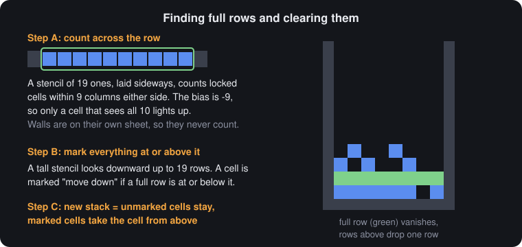</p>
<p align="center">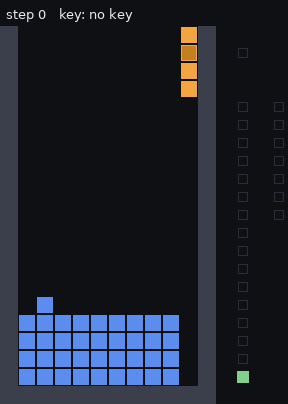</p>

| Node | What it computes | Why it exists |
|---|---|---|
| `LK` | moved piece AND lock | the cells that join the stack |
| `C` | a full row lies at or below this cell (39 × 1 kernel, ones at offsets 0 to +19) | marks every cell that must move down |
| `LKeep` | stack AND not marked | cells that stay |
| `LSh` | cell above AND marked | cells that take the value from above |
| `Lnew` | OR of the three | the new stack |

One row is cleared per step. A fixed kernel cannot shift by a variable distance, so several full rows are cleared on consecutive steps. Spawning waits until all of them are gone. This also makes the line count exact, since exactly one line is cleared per step.

### Spawn and game over (8 nodes)

<p align="center">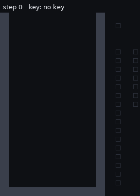 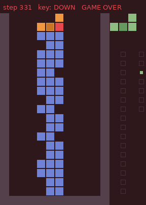</p>

| Node | What it computes | Why it exists |
|---|---|---|
| `e` | no piece AND no full row AND not game over | when to spawn |
| `ASp`, `PSp` | preview shifted 8 columns left (1 × 17 kernel, single 1 at the right end), gated by `e` | spawning is a copy |
| `Anew`, `Pnew` | OR of the fallen, unchanged and spawned pieces | the next `A` and `P` channels |
| `ovS`, `ge` | spawned piece AND stack, on a spawn step; any overlap | the stack has reached the top |
| `Gnew` | old game over OR new game over, on every cell | the next `G` channel; once set, every action is vetoed |

### Preview and random (17 nodes)

<p align="center">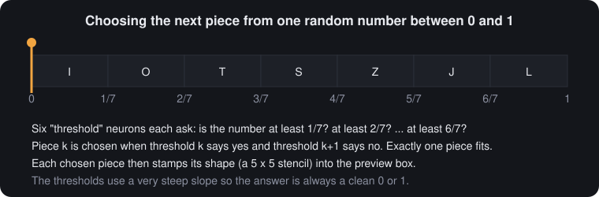</p>

| Node | What it computes | Why it exists |
|---|---|---|
| `h1` to `h6` | random number ≥ k/7, as `clamp01(7×10⁹ · r − k×10⁹)` | six steps that split [0, 1) into seven equal bins |
| `D0` to `D6` | step k on AND step k+1 off, AND spawn step, at the anchor cell (`MQ`, the preview pivot position) | exactly one piece is chosen, at one cell, only when spawning |
| `QK`, `RK` | keep the old preview when nothing spawns | |
| `Qnew` | stamp the chosen piece's 5 × 5 shape | the seven shapes, mirrored because kernels read from offsets |
| `Rnew` | place the preview pivot (all pieces except O) | |

The thresholds are exact steps except in a band about 1.4×10⁻¹⁰ wide just above each k/7. A random number landing there would produce a fractional cell; it has never happened.

### Timer (3 nodes)

| Node | What it computes | Why it exists |
|---|---|---|
| `TS` | the token moves down its 7-cell column, masked by `MT` | the clock ticks |
| `TI` | a new token at the top of the column when the column is empty (kernel −1, 1, 0 finds the top) | the clock restarts |
| `Tnew` | OR of the two | one cycle is 8 steps, or 0.8 s at 10 steps per second |

### Score (3 nodes)

<p align="center">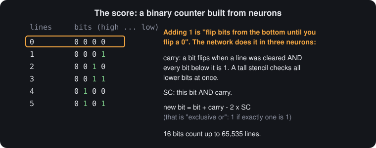</p>

| Node | What it computes | Why it exists |
|---|---|---|
| `carry` | a line is being cleared AND every lower bit is 1 (31 × 1 kernels over `S` and `MS`) | decides which bits flip, for all bits at once |
| `SC` | bit AND carry | needed to form the XOR |
| `Snew` | bit + carry − 2 × `SC`, which is bit XOR carry | adds 1 to the 16-bit score |

### Fixtures (4 nodes)

`Wc`, `MQc`, `MSc` and `MTc` copy the four static channels (weight 1, bias 0).

### What is not the network

| Code | What it does | What it never does |
|---|---|---|
| `engine.js` (145 lines) | cross-correlation, sum over a whole map, broadcast of a scalar, clamp, in the order of `graph.txt` | branch on any cell's value |
| page script (about 55 lines) | queues keys (at most 2, one per step), supplies `Math.random()`, steps 10 times a second, paints each channel a color | check collisions, keep score or decide anything about pieces |
| `build.js` | pastes the engine and every text file into `play.html` verbatim | parse or change a value |
| `sim.js`, `play.js`, `docs/` scripts | run forward passes and record outputs, for tests and figures | read the weight files |

[`AUDIT.md`](AUDIT.md) goes through each file line by line.

## Project rules

The project owner and a language model drafted the goal together, then set it as the standing goal word for word. The full text is in [`GOAL.md`](GOAL.md). Its key rules:

* **Parameters are text.** Every weight and bias is a number in a text file, and it may only be created or changed by editing that file.
* **No training.** No gradient descent, evolutionary search, reinforcement learning or data fitting.
* **No generators.** No program may produce weight values. This is the main difference from [SynapseWrite](https://github.com/dirktheeng/SynapseWrite), where a generator program writes the weights.
* **Read-only debugging.** Forward passes may be run to watch a failure. Its cause must be found by reading the weight files, not with a program that analyzes them.
* **A thin host.** The host may only:
  * load the files and apply the fixed architecture;
  * encode keys and supply one random number;
  * draw the output.

Questions settled before the work began:

| Question | Decision |
|---|---|
| Forward passes while debugging | allowed |
| Randomness | the host supplies one uniform number per step; the network turns it into a piece |
| Input and output | screen and key in, next screen out |
| Board | standard 10 × 20 |
| Size | as compact as possible, with every choice explained |
| Activations | any, with a stated reason |

## What kind of thing is this?

### Is it a circuit?

<p align="center"></p>

Yes, and an unusually clean one, because every value is a single bit.

| Circuit | This network |
|---|---|
| netlist | `graph.txt` plus the kernels |
| combinational logic | one forward pass |
| gate depth | 14 |
| registers | the 12 screen channels, fed back by the host |
| clock | one step (100 ms) |
| replicated logic cells | a map node: one gate configuration repeated at 336 cells |
| wide OR or counter | a scalar node: a sum over a whole map, then a threshold |
| enable line | a scalar node broadcast back to every cell |

SynapseWrite is mostly mixed-signal: one-bit gates switch whole numbers. This network is purely digital. Every node outputs 0 or 1 at every cell, except for the random-number band noted above. The closest hardware picture is a cellular array, like an FPGA fabric where every cell of a plane has the same configuration.

The comparison stops at three points. A sum over a whole map is computed at once, not by a real tree of gates with delays. The zero padding at the board's edges plays the role of fixed edge wiring. And the random number is an analog input that the network converts into bits.

### How do we classify it?

We call it a **hand-written neural program**. It is a fixed, weight-shared, recurrent threshold network. Its weights implement a complete interactive game, and every value was chosen individually.

| Term | Does it fit? | Why |
|---|---|---|
| neural network | yes | weighted sums, an activation, depth and recurrence; no learning |
| convolutional network | yes | every map node is a cross-correlation with shared weights |
| cellular automaton | close | the update is local plus a few global checks; a pure cellular automaton has no global checks |
| circuit | yes | purely digital; see above |
| Weight-Space Programming | yes, in its strictest form | see below |
| machine learning | no | no data, loss, gradient or search |

**Is this Weight-Space Programming?** The case for: a language model wrote every value directly into the weight files from a natural-language spec, with no optimizer, compiler or generator. That is the strictest form the original post describes. In SynapseWrite a generator writes the weights; here the weight files *are* the source code. The case against, or at least the limits: the network worked on its first run, so the "read the weights and repair them" half of the method was never exercised. The design was also worked out in reasoning before any file was written, which is close to compiling by hand. And at 1,035 numbers, the network is tiny next to the models in the original post.

| Level of work | How often | Example |
|---|---|---|
| reasoning about what each node must compute | all design | "a cell belongs to the rotated piece if the pivot is at x − Rd and a piece cell is at x − Rd + d" |
| typing values into weight files | every file, once | `weights/U1.txt` |
| running forward passes and reading screens | all testing | every rotation, clear and the full game |
| reading weight files to find a bug | never needed | no weight ever needed changing |

Every value was chosen for a logical reason. The gate weights (±1), gate biases (0, ±1, −2), thresholds (−3, −9) and vetoes (−2, −10) follow from the logic. The 5 × 5 piece kernels were drawn from the seven tetromino shapes. The slope 7×10⁹ was picked so the thresholds stay round numbers. No value came from data or an optimizer.

### Related work

| Line of work | Example | How weights are made | Relationship |
|---|---|---|---|
| threshold logic | McCulloch and Pitts, 1943 | designed logic | its foundation |
| hand-set convolutional automata | [Springer and Kenyon, 2020](https://arxiv.org/abs/2009.01398): a minimal Game of Life network | hand-written | the closest relative; they also found that the same minimal network rarely *learns* the rule by training |
| neural compilers | [Siegelmann, 1994](https://mlanthology.org/aaai/1994/siegelmann1994aaai-neural); [Gruau et al., 1995](https://gpbib.cs.ucl.ac.uk/gp-html/DBLP_journals_tcs_GruauRW95.html); [Carreira et al., 1998](https://core.ac.uk/download/32330732.pdf) | compiled | the same kind of result, produced by a compiler |
| compiled transformers | [Tracr, 2023](https://arxiv.org/abs/2301.05062); [Looped transformers, 2023](https://proceedings.mlr.press/v202/giannou23a.html) | compiled or constructed | programmed weights, with different goals |
| generator-written applications | [SynapseWrite](https://github.com/dirktheeng/SynapseWrite), a word processor as one network | written by a generator program | a sibling project, written one level up |
| learned game engines | [GameNGen, 2024](https://arxiv.org/abs/2408.14837) (DOOM); World Models; GameGAN | trained on recorded play | the opposite method: far richer games, approximate rather than exact |

These points may be unusual, though no full literature survey has been done, so no claim to be first is made:

- a complete interactive game in which every parameter was written by hand, with no compiler or generator;
- global game rules ("is any cell blocked?", "is any row full?", "is the game over?") inside a convolutional automaton, using scalar nodes that sum a map and broadcast the answer back;
- the entire game state, including the clock, the random choice and the score, kept on the visible screen.

### Determinism

The only randomness is the number the host passes in. Given the same starting screen, keys and random numbers, the output is identical every time. In the browser `Math.random()` supplies the number, so piece order differs from game to game, by design.

The arithmetic is exact, not just repeatable. Apart from the random-number thresholds, every sum is a small integer, which floating point represents exactly. A wrong result would be an ordinary bug: repeatable, traceable to a specific node, and fixed by editing that node's file. The network has no learned statistics and generates no content, so it cannot "hallucinate". This README was also written with a language model, and its numbers were checked against the files or measured from forward passes, but documentation can still contain errors.

## Evidence and reference

### How it is checked

Every check drives the network with keys and judges only the output screens. `sim.js` prints the screen after each step.

| Check | Command | Result |
|---|---|---|
| walls stop moves | `node sim.js screen0.txt "..lllllllrrrrrrrrrr" 1 1` | the piece stops at both walls |
| T rotation | `node sim.js tests/clear_T.txt "dd.u..u..u..u.." 1 1` | four orientations, back to the start |
| I rotation and refusal | `node sim.js tests/irot.txt "dduuurru" 1 1` | the last turn, into the right wall, is refused |
| each piece clears and scores | `node sim.js tests/clear_<P>.txt "lr$(printf 'd%.0s' {1..19})...." 1 1`, for P in I O T S Z J L | the row clears and the score goes from 0 to 1 |
| four lines | `node sim.js tests/clear4.txt "$(printf 'd%.0s' {1..17})......" 1 1` | four rows clear on four steps; the score goes 1 → 5 |
| all seven pieces | one step from `screen0.txt` with the random number at each bin center | I, O, T, S, Z, J, L appear in the preview |
| full game | `node sim.js screen0.txt "$(cat tests/full_game_seed42.txt)" 42 1` | 512 steps, every piece used, one line cleared, ends in game over |
| page script | the built page's script run headless in Node, with the recorded keys and a seeded random | the same final screen as the full-game check |
| host audit | [`AUDIT.md`](AUDIT.md) | no game logic outside the network |

One forward pass takes about 0.36 ms, measured in Node on one 2.1 GHz Xeon core, against a 100 ms step period.

### Design decisions

| Decision | Alternative considered | Reason |
|---|---|---|
| the screen is the whole state | hidden recurrent state | required by the goal; makes everything visible |
| 12 binary channels | one channel with codes | codes would need decoding nodes; binary channels make every rule a gate |
| a separate wall channel | treat the screen edge as a wall | one uniform collision test; walls stay out of the row count |
| clamp01 everywhere | ReLU, sigmoid | exact gates that stay binary over any number of steps |
| kernels with shared weights | fully connected layers | about 300 times fewer numbers; each rule written once |
| test the move, then check for overlap | compute legal moves directly | the smallest exact collision check, reused for every move |
| pivot rotation with 12 detectors | tables per piece and orientation | one mechanism for every piece; O is handled by the "4 cells" test |
| classic rotation | SRS with wall kicks | wall kicks would need many more nodes |
| spawn by copying the preview | draw each new piece from scratch | one copy kernel |
| one line cleared per step | clear all full lines at once | a fixed kernel cannot shift by a variable distance; the line count becomes exact |
| timer on the screen | a tick from the host | timing is a game rule |
| binary line count | classic points | multi-line clears are never seen at once; 16 cells count to 65,535 |

### Repository tour

| Path | What is there |
|---|---|
| `graph.txt` | the architecture: node types, wiring, kernel sizes |
| `weights/` | the 87 hand-written weight files |
| `screen0.txt` | the starting screen |
| `engine.js` | the executor |
| `play.template.html`, `build.js`, `play.html` | the browser page source, its build script, and the built game |
| `sim.js`, `play.js` | forward-pass harnesses: a scripted run, and play one decision at a time |
| `tests/` | test screens and the recorded game |
| `GOAL.md`, `DESIGN.md`, `AUDIT.md` | the goal, the per-file design note, the host audit |
| `docs/img/` | figures (drawn by hand) and animations (recorded from forward passes) |
| `docs/make_gifs.py`, `docs/figures_src/` | recorders and the atlas script; they read screens and node outputs, never the weight files |

### References

* *Weight-Space Programming* (blog post). https://rikiyat.github.io/blog/weight-space-programming/
* W. S. McCulloch and W. Pitts, "A Logical Calculus of the Ideas Immanent in Nervous Activity," *Bulletin of Mathematical Biophysics*, 1943.
* J. M. Springer and G. T. Kenyon, "It's Hard for Neural Networks to Learn the Game of Life," 2020. https://arxiv.org/abs/2009.01398
* D. Lindner et al., "Tracr: Compiled Transformers as a Laboratory for Interpretability," 2023. https://arxiv.org/abs/2301.05062
* A. Giannou et al., "Looped Transformers as Programmable Computers," ICML 2023. https://proceedings.mlr.press/v202/giannou23a.html
* D. Valevski et al., "Diffusion Models Are Real-Time Game Engines," 2024. https://arxiv.org/abs/2408.14837
* SynapseWrite, a word processor as one weight-programmed network. https://github.com/dirktheeng/SynapseWrite
